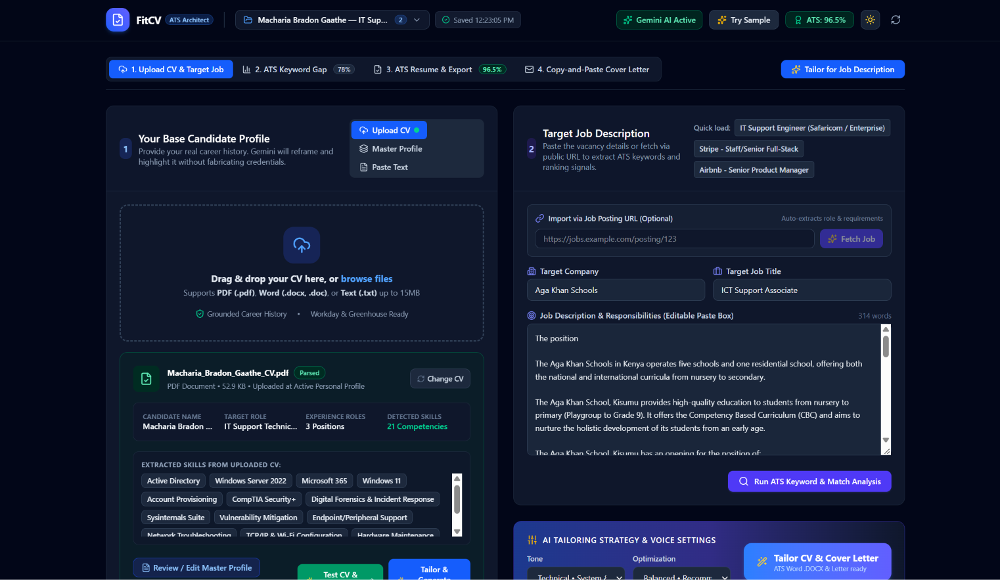

<article class="container section animate-entrance">
  

    Case Study
    <h1 class="display-font">FitCV</h1>
    
    

      

        
Status

        
Prototype / Under Development

      

      

        
Implementation

        
AI-Assisted Development

      

      

        
Intended Users

        
Personal career development

      

    

  

  

    

      Fig. 1 — App Interface
      
    

    <h2>The Problem</h2>
    
Tailoring a CV for every unique job application is a repetitive and error-prone process. FitCV provides independent CV tailoring based on job descriptions, with an optional handoff directly from Opportunity Radar to streamline application preparation.

    <h2>My Contribution & Approach</h2>
    
My contribution is focused on product direction, requirement setting, and rigorous validation of the tailored outputs. The code implementation was heavily AI-assisted, directed by my architectural requirements and workflow design.

    <h2>Current Status & Evidence</h2>
    
Basic CV tailoring logic and handoff processes are prototyped. Deep document formatting and complex edge-case matching remain unverified.

    
    <h2>Lessons Learned</h2>
    
Learning how to integrate distinct personal tools (Opportunity Radar and FitCV) into a cohesive, automated workflow without losing human oversight.

  

</article>
