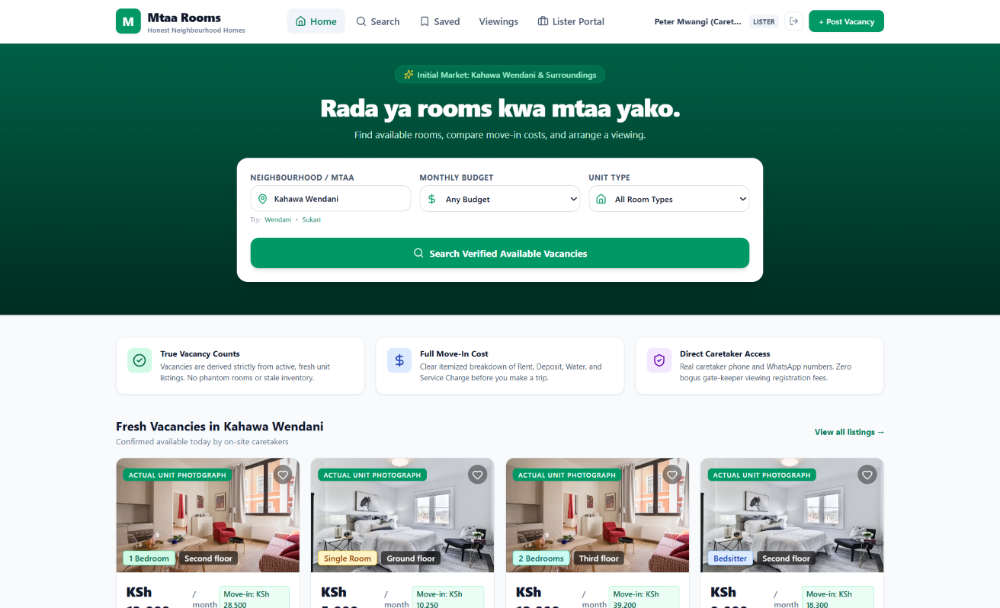
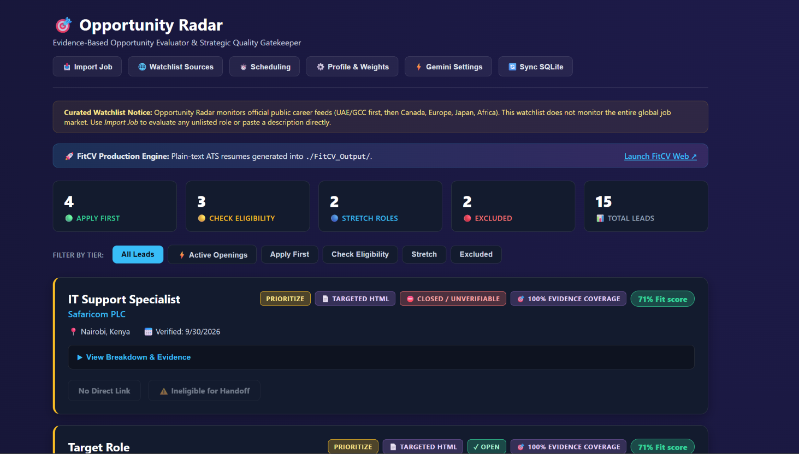
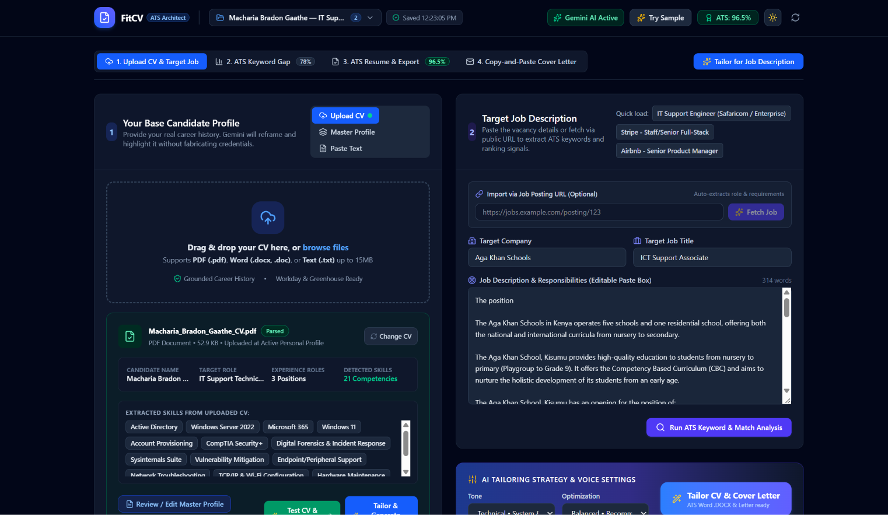

  

    Application Projects
    <h1 class="display-font">Software Prototypes</h1>
    

      Personal software prototypes focusing on real-world problems. Development is AI-assisted, with my contribution focused on product direction, requirement specification, and rigorous logic validation.
    

  

  

    <!-- Project 1 -->
    <article class="project-showcase">
      

        <h3 class="display-font">Mtaa Rooms</h3>
        
Status: Prototype / AI-Assisted Development

        
<strong>The Problem:</strong> Rental discovery focused on ordinary room seekers navigating scattered local listings.

        
<strong>My Contribution:</strong> Product direction, user requirements, and rigorous logic validation.

        <a href="/apps/mtaa-rooms/" class="btn btn-outline" style="margin-top: 1rem;">Read Case Study</a>
      

      

        Fig. A - App Interface
        
      

    </article>

    <!-- Project 2 (Alt Layout) -->
    <article class="project-showcase alt">
      

        <h3 class="display-font">Opportunity Radar</h3>
        
Status: Prototype / AI-Assisted Development

        
<strong>The Problem:</strong> Manual evaluation of job descriptions against a specific professional profile is subjective and slow.

        
<strong>My Contribution:</strong> Evaluation rubric design, requirement specification, and handoff architecture.

        <a href="/apps/opportunity-radar/" class="btn btn-outline" style="margin-top: 1rem;">Read Case Study</a>
      

      

        Fig. B - App Interface
        
      

    </article>

    <!-- Project 3 -->
    <article class="project-showcase">
      

        <h3 class="display-font">FitCV</h3>
        
Status: Prototype / AI-Assisted Development

        
<strong>The Problem:</strong> Repetitive CV tailoring requires independent automation without losing human oversight.

        
<strong>My Contribution:</strong> Workflow design, structural requirements, and integration validation.

        <a href="/apps/fitcv/" class="btn btn-outline" style="margin-top: 1rem;">Read Case Study</a>
      

      

        Fig. C - App Interface
        
      

    </article>
  

