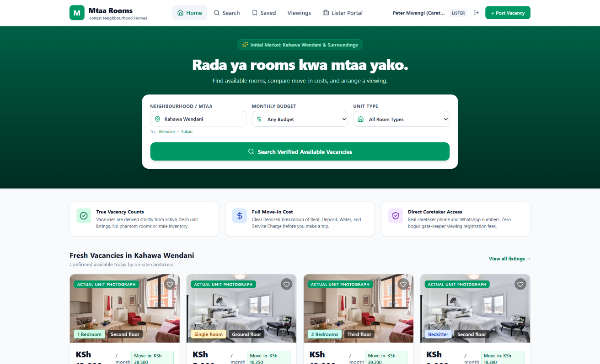

<article class="container section animate-entrance">
  

    Case Study
    <h1 class="display-font">Mtaa Rooms</h1>
    
    

      

        
Status

        
Prototype / Under Development

      

      

        
Implementation

        
AI-Assisted Development

      

      

        
Intended Users

        
Ordinary room seekers

      

    

  

  

    

      Fig. 1 — App Interface
      
    

    <h2>The Problem</h2>
    
Traditional rental listings are often scattered, unreliable, or inaccessible to the average person. The core challenge is creating a discovery flow tailored specifically for ordinary room seekers, simplifying the process of finding and verifying local accommodations.

    <h2>My Contribution & Approach</h2>
    
My primary role encompasses product direction, defining user requirements, and conducting rigorous review of the application logic. I approached this by mapping out the exact data required to verify a listing, and building structured requirements for an AI assistant to implement. The actual code generation was highly AI-assisted, but guided by my architectural decisions.

    <h2>Current Status & Evidence</h2>
    
The core concept and UI layout are established as a working prototype. However, production readiness, real-world scalability, and security validation remain unverified. 

    
    <h2>Lessons Learned</h2>
    
This project has been an exercise in navigating the boundary between high-level product design and technical execution. I learned the critical importance of writing precise requirements for an AI assistant and independently validating the generated implementation logic.

  

</article>
