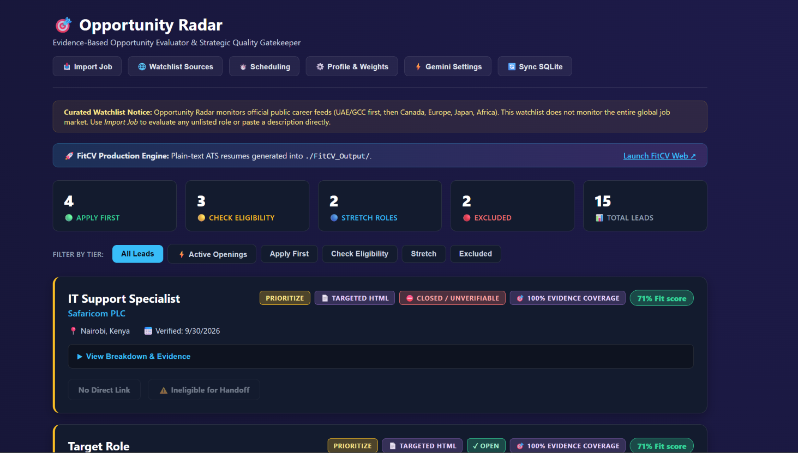

<article class="container section animate-entrance">
  

    Case Study
    <h1 class="display-font">Opportunity Radar</h1>
    
    

      

        
Status

        
Prototype / Under Development

      

      

        
Implementation

        
AI-Assisted Development

      

      

        
Intended Users

        
Personal career development

      

    

  

  

    

      Fig. 1 — App Interface
      
    

    <h2>The Problem</h2>
    
Evaluating job descriptions and professional opportunities against one's specific skill set can be time-consuming and subjective. Opportunity Radar provides a structured, automated personal opportunity assessment to determine how well an open role aligns with my profile.

    <h2>My Contribution & Approach</h2>
    
My primary contribution lies in product direction, requirement specification, and rigorous validation of the assessment logic. The implementation process was heavily AI-assisted, translating my evaluation criteria into functional code.

    <h2>Current Status & Evidence</h2>
    
Opportunity ingestion and basic assessment logic are prototyped. However, edge-case accuracy and performance at scale remain unverified.

    
    <h2>Lessons Learned</h2>
    
Refining evaluation rubrics into programmable logic and managing the handoff between assessment tools and resume tailoring tools.

  

</article>
