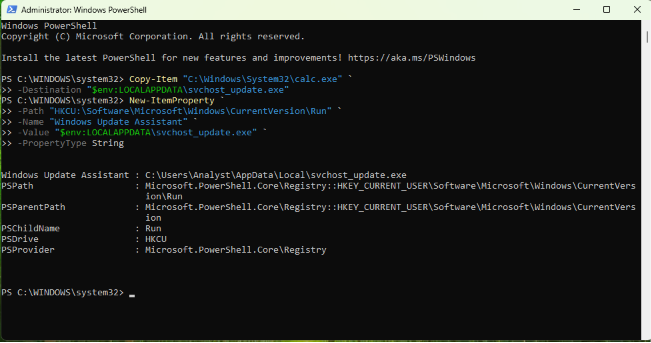
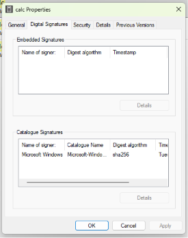
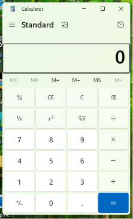

  

    Independent Home Lab
    <h1 class="display-font">Registry Run Key Persistence &amp; Process Masquerading</h1>
    

      <strong>Lab Status:</strong> Completed
      <strong>Documentation:</strong> Published
    

    

      MITRE T1547.001
      MITRE T1036
      Windows Registry
      PowerShell
      Signature Analysis
    

  

  

  

    <em>Note: This is an independent home lab investigation and not a professional SOC or client incident-response experience.</em>
  

  <h2 class="display-font mt-lg">Objective and Scope</h2>
  
To investigate and document how adversaries achieve persistence using Windows Registry Run keys, and to analyze process masquerading techniques where malicious executables disguise themselves as legitimate system binaries.

  <h2 class="display-font mt-lg">Lab Environment</h2>
  <ul class="styled-list">
    <li>Windows Environment (VMware)</li>
    <li>PowerShell</li>
  </ul>

  <h2 class="display-font mt-lg">What I Personally Did</h2>
  <ul class="styled-list">
    <li>Configured an isolated Windows virtual machine.</li>
    <li>Used PowerShell to copy a payload and establish persistence via the <code>HKCU\Software\Microsoft\Windows\CurrentVersion\Run</code> registry key.</li>
    <li>Executed a masquerading attack by renaming the payload to mimic a legitimate binary (<code>calc.exe</code>).</li>
    <li>Investigated the anomalous binary by analyzing its digital signature and file details.</li>
    <li>Verified the successful execution and persistence of the payload upon system reboot.</li>
  </ul>

  <h2 class="display-font mt-lg">Observations and Supporting Evidence</h2>
  
The investigation demonstrated that relying solely on process names (e.g., <code>calc.exe</code>) is insufficient for threat hunting. The examined binary displayed a legitimate Microsoft signature, illustrating that attackers often copy, rename, and misuse legitimate signed software (Living-off-the-Land) to blend in. Therefore, a valid signature alone does not rule out malicious intent, and must be combined with behavioral and path analysis.

  <figure class="case-figure">
    Fig. A — Payload Persistence via Registry
    
  </figure>

  

  <figure class="case-figure case-figure--compact">
    Fig. B — Signature Verification
    
  </figure>
  <figure class="case-figure case-figure--compact">
    Fig. C — Persistence Verified
    
  </figure>
  

  <h2 class="display-font mt-lg">Lessons Learned and Limitations</h2>
  
This lab reinforced the necessity of defense-in-depth and behavioral analysis. A limitation of this isolated exercise is that it did not simulate enterprise EDR (Endpoint Detection and Response) telemetry, which would likely flag the anomalous registry modification immediately.

  <h2 class="display-font mt-lg">Verified Repository</h2>
  

    <a href="https://github.com/machariaBG/DFIR-Case-01-Registry-Persistence" target="_blank" rel="noopener noreferrer" class="btn btn-outline btn-sm">View GitHub Repository</a>
  

  <nav class="case-nav" aria-label="Home lab navigation">
    <a href="/home-labs/" class="btn btn-outline btn-sm">&larr; All Home Labs</a>
    <a href="/home-labs/winpmem/" class="btn btn-outline btn-sm">Next: Scheduled Task &amp; Memory Acquisition &rarr;</a>
  </nav>
  

