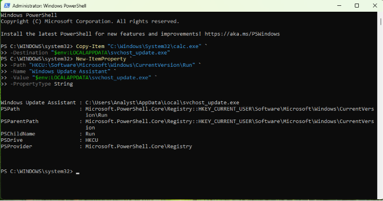
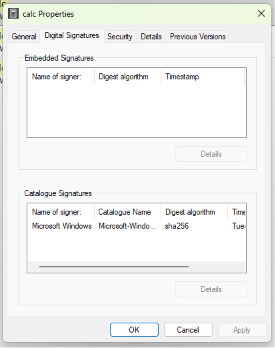

  

    Independent Home Lab
    <h1 class="display-font">Registry Run Key Persistence & Process Masquerading</h1>
    

      <strong style="color:var(--color-navy);">Lab Status:</strong> Completed
      <strong style="color:var(--color-navy);">Documentation:</strong> Published
    

  

  

    

      <em>Note: This is an independent home lab investigation and not a professional SOC or client incident-response experience.</em>
    

    <h2 class="display-font" style="margin-top: var(--space-lg);">Objective and Scope</h2>
    
To investigate and document how adversaries achieve persistence using Windows Registry Run keys, and to analyze process masquerading techniques where malicious executables disguise themselves as legitimate system binaries.

    <h2 class="display-font" style="margin-top: var(--space-lg);">Lab Environment</h2>
    <ul style="list-style-type: square; color: var(--color-ink-light); padding-left: 1.2rem;">
      <li>Windows Environment (VMware)</li>
      <li>PowerShell</li>
    </ul>

    <h2 class="display-font" style="margin-top: var(--space-lg);">What I Personally Did</h2>
    <ul style="list-style-type: square; color: var(--color-ink-light); padding-left: 1.2rem;">
      <li>Configured an isolated Windows virtual machine.</li>
      <li>Used PowerShell to copy a payload and establish persistence via the <code>HKCU\Software\Microsoft\Windows\CurrentVersion\Run</code> registry key.</li>
      <li>Executed a masquerading attack by renaming the payload to mimic a legitimate binary (<code>calc.exe</code>).</li>
      <li>Investigated the anomalous binary by analyzing its digital signature and file details.</li>
      <li>Verified the successful execution and persistence of the payload upon system reboot.</li>
    </ul>

    <h2 class="display-font" style="margin-top: var(--space-lg);">Observations and Supporting Evidence</h2>
    
The investigation demonstrated that relying solely on process names (e.g., <code>calc.exe</code>) is insufficient for threat hunting. The examined binary displayed a legitimate Microsoft signature, illustrating that attackers often copy, rename, and misuse legitimate signed software (Living-off-the-Land) to blend in. Therefore, a valid signature alone does not rule out malicious intent, and must be combined with behavioral and path analysis.

    
    

      
      Fig. A - Payload Persistence via Registry
    

    

      
      Fig. B - Signature Verification of Masqueraded Binary
    

    <h2 class="display-font" style="margin-top: var(--space-lg);">Lessons Learned and Limitations</h2>
    
This lab reinforced the necessity of defense-in-depth and behavioral analysis. A limitation of this isolated exercise is that it did not simulate enterprise EDR (Endpoint Detection and Response) telemetry, which would likely flag the anomalous registry modification immediately.

    <h2 class="display-font" style="margin-top: var(--space-lg);">Verified Repository</h2>
    

      <a href="https://github.com/machariaBG/DFIR-Case-01-Registry-Persistence" target="_blank" rel="noopener noreferrer" class="btn btn-outline" style="font-size: 0.85rem; padding: 0.5rem 1rem;">View GitHub Repository</a>
    

  

