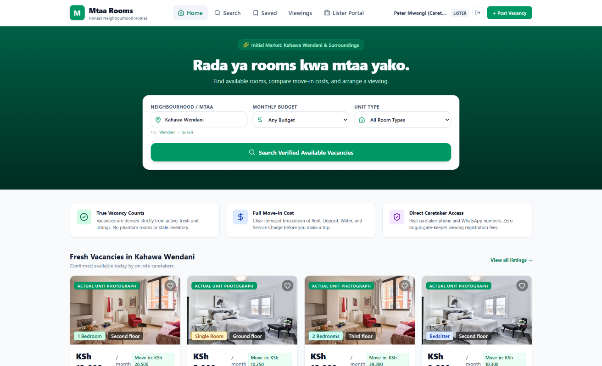
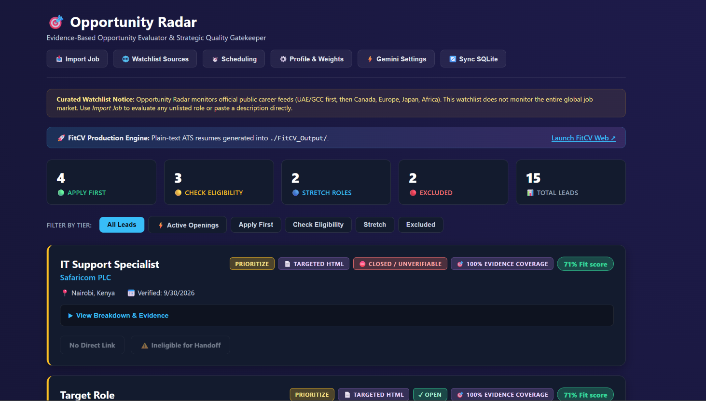
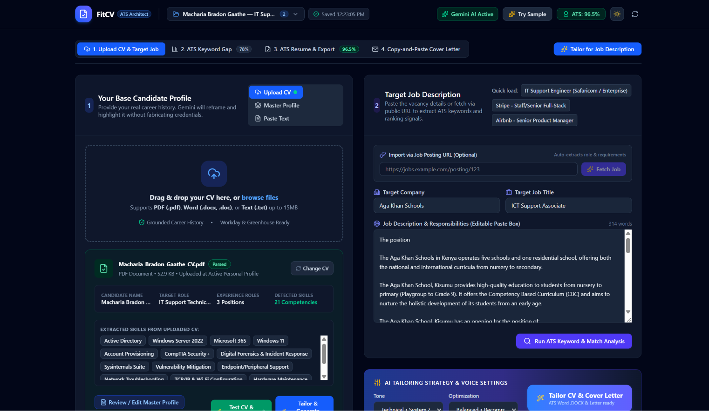
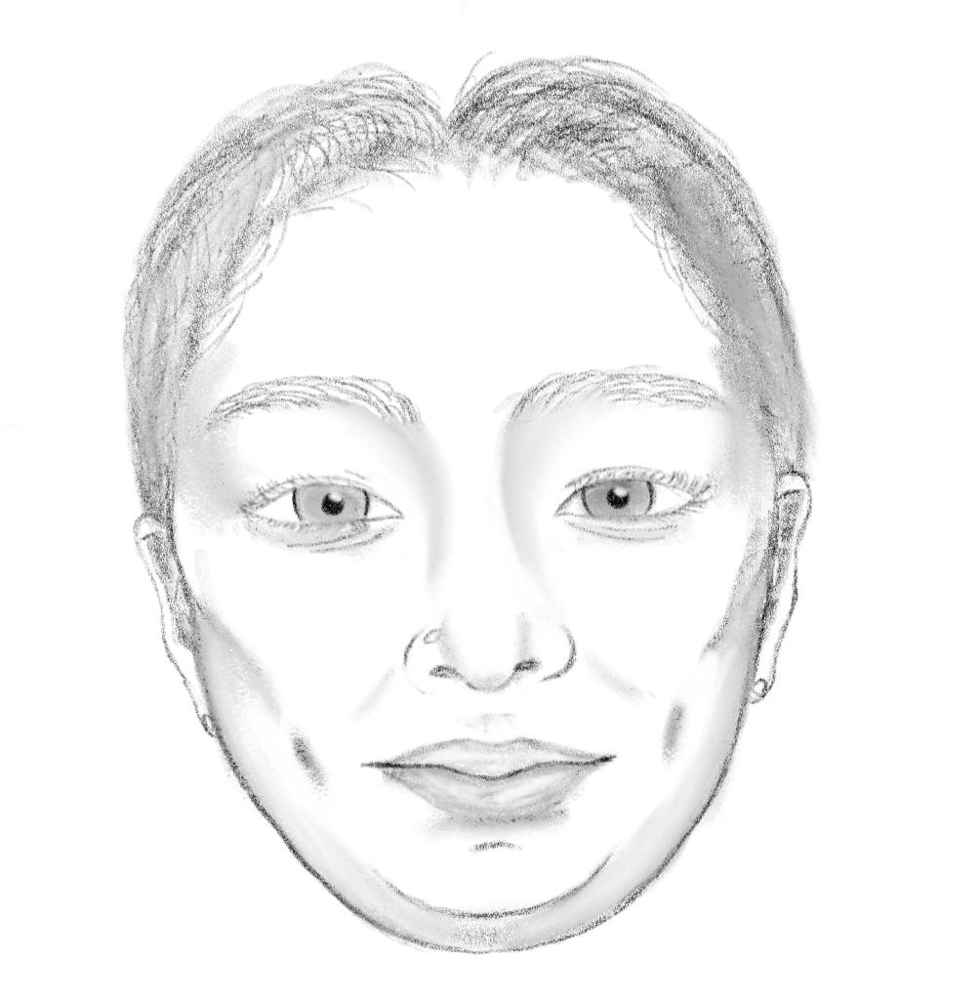

  <section class="hero grid">
    

      01. Identity & Direction
      <h1 style="margin-bottom: var(--space-xs);">Bradon Gaathe Macharia.</h1>
      
<strong>IT Support & Technical Operations &middot; Digital Forensics & Cybersecurity</strong>

      
I enjoy understanding how things work—and making technology easier for people to use. My approach combines methodical troubleshooting from gaming operations with continuous hands-on exploration in cybersecurity labs.

      

        <a href="#selected-work" class="btn">Explore my work</a>
        <a href="/contact/" class="btn btn-outline">Contact me</a>
      

    

    

      

        <video id="hero-video" autoplay loop muted playsinline class="video-frame" aria-label="Animated greeting">
          <source src="/assets/images/heeyy.mp4" type="video/mp4">
          Your browser does not support the video tag.
        </video>
        <button id="video-toggle" class="video-controls" aria-label="Pause animation">
          <!-- Pause icon SVG -->
          <svg width="12" height="12" viewBox="0 0 24 24" fill="currentColor"><path d="M6 19h4V5H6v14zm8-14v14h4V5h-4z"/></svg>
        </button>
        
heeyy 👋

      

    

  </section>

<section class="foundation-strip">
  

    02. Professional Foundation
    <h2>Experience & Education</h2>
    

      

        
12 June 2023 - 27 April 2026

        
Game Operator

        
Q8 Tech, Kuwait. Hardware troubleshooting, equipment maintenance, and customer assistance.

      

      

        
Kenyatta University

        
BSc Forensic Science

        
Analytical foundation for structured problem solving.

      

      

        
Passed 28 August 2026

        
CompTIA Security+

        
SY0-701 certification validating core security and troubleshooting principles.

      

    

  

</section>

  03. Selected Work
  <h2>Application Projects</h2>

  <!-- Project 1 -->
  <article class="project-showcase">
    

      <h3 class="display-font">Mtaa Rooms</h3>
      
Status: Prototype / AI-Assisted Development

      
<strong>The Problem:</strong> Rental discovery focused on ordinary room seekers navigating scattered local listings.

      
<strong>My Contribution:</strong> Product direction, user requirements, and rigorous logic validation.

      <a href="/apps/mtaa-rooms/" class="btn btn-outline" style="margin-top: 1rem;">Read Case Study</a>
    

    

      Fig. A - App Interface
      
    

  </article>

  <!-- Project 2 (Alt Layout) -->
  <article class="project-showcase alt">
    

      <h3 class="display-font">Opportunity Radar</h3>
      
Status: Prototype / AI-Assisted Development

      
<strong>The Problem:</strong> Manual evaluation of job descriptions against a specific professional profile is subjective and slow.

      
<strong>My Contribution:</strong> Evaluation rubric design, requirement specification, and handoff architecture.

      <a href="/apps/opportunity-radar/" class="btn btn-outline" style="margin-top: 1rem;">Read Case Study</a>
    

    

      Fig. B - App Interface
      
    

  </article>

  <!-- Project 3 -->
  <article class="project-showcase">
    

      <h3 class="display-font">FitCV</h3>
      
Status: Prototype / AI-Assisted Development

      
<strong>The Problem:</strong> Repetitive CV tailoring requires independent automation without losing human oversight.

      
<strong>My Contribution:</strong> Workflow design, structural requirements, and integration validation.

      <a href="/apps/fitcv/" class="btn btn-outline" style="margin-top: 1rem;">Read Case Study</a>
    

    

      Fig. C - App Interface
      
    

  </article>

  04. Field Notes
  <h2>Independent Home Labs</h2>
  
<strong>Note:</strong> Separate from employment. These are educational exercises.

  
  

    

      <h3>Active Directory Access Control</h3>
      
Isolated lab (Server 2022 / Win 11) to practice identity workflows, NTFS permissions, and offboarding simulations.

      <a href="/home-labs/active-directory/">View case study &rarr;</a>
    

    

      <h3>Registry Run Key Persistence</h3>
      
Investigation into process masquerading and persistence mechanisms.

      <a href="/home-labs/registry-run-key/">View case study &rarr;</a>
    

    

      <h3>Volatile Memory Acquisition</h3>
        
Scheduled task persistence analysis using WinPmem.

        <a href="/home-labs/winpmem/">View case study &rarr;</a>
    

  

  05. Sketches
  

    

      <h2 class="display-font">Interests & Observation</h2>
      
I enjoy drawing and exploring how technology can help people. One of my long-term goals is to make digital-security education more accessible to Kenyan communities.

      

        <a href="/assets/images/Drawing2.png" class="gallery-item" aria-label="View Concept Sketch">
          
          

            Concept Sketch
            Digital Drawing
          

        </a>
        <a href="/assets/images/sketch1.jpeg" class="gallery-item" aria-label="View Field Notes">
          
          

            Field Notes
            Pen on Paper
          

        </a>
      

      <a href="/interests/" class="btn btn-outline" style="margin-top: 1rem;">View Full Gallery</a>
    

  

